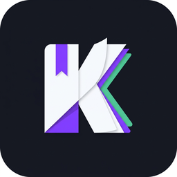

# KaviReader

<p align="center">
  
</p>

<p align="center">
  <strong>An open-source, mobile-first Android reader client for self-hosted <a href="https://www.kavitareader.com/">Kavita</a> digital library servers.</strong>
</p>

<p align="center">
  <a href="https://opensource.org/licenses/MIT"></a>
  <a href="https://android.com"></a>
  <a href="https://gitlab.com/fdroid/fdroiddata/-/merge_requests/55127"></a>
  <a href="https://capacitorjs.com"></a>
  <a href="https://vite.dev"></a>
</p>

---

## 📖 Overview

**KaviReader** is a dedicated Android companion client engineered specifically for [Kavita](https://www.kavitareader.com/) media servers. While Kavita provides an excellent web application, reading on mobile and e-ink devices benefits immensely from a native container designed around touch gestures, edge-to-edge full-screen reading, hardware volume-key navigation, and offline chapter caching.

This app is completely open source under the **MIT License**, built using React, Vite, Tailwind CSS, and Capacitor, and adheres strictly to F-Droid's inclusion policies with **zero ads, zero tracking, and zero proprietary analytics**.

---

## ✨ Features

- **📚 Full Library Exploration**
  - Browse libraries, series, collections, reading lists, and want-to-read lists.
  - Rich metadata views with genres, age ratings, publication status, and author details.
  - Server-side search and filtering across your entire digital collection.

- **🎨 Dedicated Manga & Comic Reader**
  - **Multiple Reading Modes**: Continuous vertical scroll (optimized for Webtoons), Right-to-Left (Manga), Left-to-Right (Western comics), and Vertical pagination.
  - **Edge-to-Edge Immersive Display**: Hides system bars during reading for maximum canvas space.
  - **Hardware Key Navigation**: Flip pages smoothly with device volume buttons.
  - **Smart Image Fitting**: Automatic fit-to-width, fit-to-height, or original size scaling.

- **📑 Advanced EPUB & Book Engine**
  - Clean typography and customizable reading themes (Light, Dark, Sepia, OLED True Black).
  - Adjustable font size, line spacing, margins, and section navigation via Table of Contents.

- **💾 Offline Bookshelf & Sync**
  - Cache chapters or entire volumes to device storage for offline reading during commutes or travel.
  - Bidirectional reading progress synchronization ensures your position is automatically updated on your Kavita server.

- **📱 Android-Centric Optimizations**
  - **Dynamic Launcher Icons**: Switch seamlessly between Classic geometric book and Modern Emblem icons in app settings.
    <p align="left">
      &nbsp;&nbsp;&nbsp;&nbsp;
      
    </p>
  - **Safe-Area Awareness**: Full support for display cutouts, camera notches, and gesture navigation bars.
  - **E-Ink Friendly**: High-contrast modes and discrete page-turning gestures tailored for e-paper devices.

- **🔒 Privacy First**
  - Connects strictly and exclusively to your specified Kavita server instance.
  - Zero telemetry, zero analytics trackers, and zero third-party cloud dependencies.

---

## 📲 Installation

### F-Droid
KaviReader is currently undergoing official packaging review in the F-Droid main repository:
- **Merge Request**: [fdroid/fdroiddata!55127](https://gitlab.com/fdroid/fdroiddata/-/merge_requests/55127)
- **Application ID**: `io.github.retsnimle.kavitareader`

### GitHub Releases
Pre-compiled APKs are available on the [Releases](https://github.com/retsnimle/kavita-android-client/releases) page.

---

## 🛠️ Building from Source

This project is built using Capacitor and standard Android Gradle tooling. The build process is fully offline-capable and compliant with F-Droid build server requirements.

### Prerequisites
- **Node.js** >= 20.x
- **npm** >= 10.x
- **JDK** 21
- **Android SDK Platform** 35 (Build-Tools `35.0.0`)

### Build Steps

```bash
# 1. Clone the repository
git clone https://github.com/retsnimle/kavita-android-client.git
cd kavita-android-client

# 2. Install web dependencies
npm ci

# 3. Build web assets and bundle Vite production build
npm run build

# 4. Sync web assets into the Android native project
npx cap sync android

# 5. Build Android APK
cd android
./gradlew assembleRelease
```

The resulting release APK will be located at:
```
android/app/build/outputs/apk/release/app-release-unsigned.apk
```

*(Note: The build steps above directly mirror the official F-Droid build recipe in `io.github.retsnimle.kavitareader.yml`.)*

---

## ⚙️ Server Requirements

- A running instance of [Kavita](https://www.kavitareader.com/) (v0.8.0 or later recommended).
- Network access to your server (local IP, reverse proxy with HTTPS, or VPN like Tailscale / WireGuard).

---

## 🤝 Contributing

Contributions, bug reports, and feature requests are very welcome!
- For bugs or feature ideas, please open an issue in the [GitHub Issue Tracker](https://github.com/retsnimle/kavita-android-client/issues).
- Pull requests should target the `master` branch and maintain clean linter checks (`npm run lint`).

---

## ⚖️ Disclaimer

**KaviReader** is an independent, community-driven open-source project and is not officially affiliated with, endorsed by, or sponsored by the Kavita Core development team. The official Kavita project can be found at [kavitareader.com](https://www.kavitareader.com/).

---

## 📜 License

This project is licensed under the **MIT License** - see the [LICENSE](LICENSE) file for details.

Copyright (c) 2026 retsnimle.
