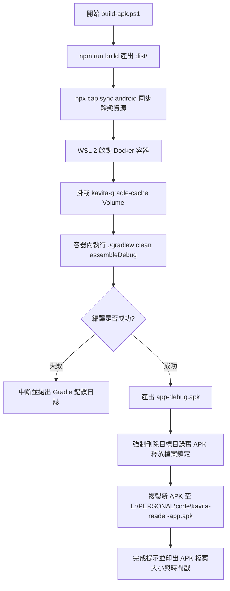

# Kavita Android Client APK 編譯指南 (Build Guide)

本文件完整記錄 **Kavita Android Client** 的環境配置、容器化編譯架構、版本控制以及自動化發布標準作業程序（SOP）。

---

## 1. 架構與技術棧

- **前端核心**：React 18 + TypeScript + Vite + Tailwind CSS + Lucide Icons
- **跨平台中介**：Capacitor 6 (`@capacitor/android`, `@capacitor/core`)
- **Android 底層**：Gradle 8.2.1 + Android SDK 34 (Java 17)
- **容器化編譯**：Docker on WSL 2 (`ghcr.io/cirruslabs/android-sdk:34`)
- **發布目標路徑**：`E:\PERSONAL\code\kavita-reader-app.apk`

---

## 2. 前置需求 (Prerequisites)

在 Windows 宿主機上需確認已安裝並具備以下工具：

1. **Node.js**：v18+ (推薦 v20 LTS) 與 `npm`。
2. **Docker Desktop**：啟動中，並已啟用 WSL 2 整合引擎（預設發行版本如 `Ubuntu-24.04`）。
3. **PowerShell 7** 或 Windows PowerShell：用於執行根目錄自動化腳本 `build-apk.ps1`。
4. **Android 實機 (除錯與安裝)**：
   - 需開啟「開發人員選項」與「USB 偵錯 / 無線偵錯」。
   - 可選：配備 ADB 工具進行無線安裝與 Log 監看。

---

## 3. 一鍵自動編譯腳本 (`build-apk.ps1`)

專案根目錄已配置一鍵編譯與同步腳本 `build-apk.ps1`。

### 執行方式
在專案根目錄 `G:\CODE\kavita-android-client` 下以 PowerShell 執行：

```powershell
.\build-apk.ps1
```

### 腳本執行流程圖


---

## 4. 手動編譯與分步詳解

若需手動逐步除錯或不透過腳本建置，請遵循以下步驟：

### Step 1: 前端構建
將 React / TypeScript 原始碼編譯打包至 `dist/` 目錄：
```powershell
npm run build
```

### Step 2: Capacitor 資源同步
將 `dist/` 內容拷貝至 `android/app/src/main/assets/public/`，並更新 Android 原生外掛配置：
```powershell
npx cap sync android
```

### Step 3: Docker 容器內編譯 Gradle
藉由 WSL 2 呼叫 Docker Android SDK 映像檔，利用獨立 Volume 快取 Gradle 依賴，避免重複下載。

```powershell
wsl -d Ubuntu-24.04 docker run --rm `
  -v kavita-gradle-cache:/root/.gradle `
  -v /mnt/g/CODE/kavita-android-client/android:/app `
  -w /app `
  ghcr.io/cirruslabs/android-sdk:34 `
  bash -c "chmod +x gradlew && ./gradlew clean assembleDebug --no-daemon"
```

> [!IMPORTANT]
> **必須加上 `clean` 參數！**
> 若未加上 `clean`，Gradle 在檢查代碼時容易將 `packageDebug` 等任務判定為 `UP-TO-DATE`，導致 Capacitor 同步進去的前端靜態檔案**完全沒有被重新封裝進 APK**，產生「有編譯但代碼沒更新」的假性成功現象。

### Step 4: 產物擷取與部署
編譯產物位於：
`android/app/build/outputs/apk/debug/app-debug.apk`

將其複製到發布目錄：
```powershell
$targetApk = "E:\PERSONAL\code\kavita-reader-app.apk"
if (Test-Path $targetApk) {
    Remove-Item -Force $targetApk
}
Copy-Item "android\app\build\outputs\apk\debug\app-debug.apk" -Destination $targetApk
```

> [!WARNING]
> **Windows 檔案鎖定注意**：
> 若目標目錄下的舊 APK 正被其它程式（如檔案總管預覽、安裝工具或手機同步器）短暫佔用，直接 `Copy-Item -Force` 可能失敗。先呼叫 `Remove-Item -Force` 確保路徑完全釋放後再行複製。

---

## 5. 版本號管理規約

每次重大改動或發布新功能時，請遞增 `android/app/build.gradle` 內的版本號：

```groovy
defaultConfig {
    applicationId "io.github.retsnimle.kavitareader"
    minSdkVersion rootProject.ext.minSdkVersion
    targetSdkVersion rootProject.ext.targetSdkVersion
    versionCode 51          // 整數遞增，確保 Android 系統允許覆蓋安裝
    versionName "1.0.50"    // 語意化版本號（主要.次要.修訂）
    testInstrumentationRunner "androidx.test.runner.AndroidJUnitRunner"
    ...
}
```

---

## 6. 實機偵錯與除錯指南

### 1. 無線 ADB 連線與安裝
當實機開啟無線偵錯後，可直接透過 ADB 指令安裝剛編譯出來的 APK：
```powershell
adb connect <手機IP>:<偵錯連接埠>
adb install -r "E:\PERSONAL\code\kavita-reader-app.apk"
```

### 2. Chrome DevTools 遠端檢查 WebView
本 App 本質上為 Capacitor 容器執行的 Web 應用。
1. 手機透過 USB 或 Wi-Fi 連線至開發電腦。
2. 啟動 Kavita Reader App。
3. 在 PC 上打開 Chrome 或 Edge，輸入網址：`chrome://inspect/#devices`。
4. 找到 `WebView in io.github.retsnimle.kavitareader`，點擊 **inspect** 即可開啟 Chrome 開發者工具，即時檢查 Console 日誌、Network 網路封包與 DOM 結構。

---

## 7. 常見故障排除 (Troubleshooting)

| 異常現象 | 可能原因 | 解決方式 |
| :--- | :--- | :--- |
| **編譯成功但 App 畫面依然是舊版** | Gradle 判定 `UP-TO-DATE` 未重新打包資產。 | 確保使用 `./gradlew clean assembleDebug` 進行全量乾淨編譯。 |
| **`E:\PERSONAL\code\kavita-reader-app.apk` 存取被拒** | 檔案被 Windows 檔案總管或其他進程鎖定。 | 執行 `Remove-Item -Force`，或手動關閉佔用該檔案的視窗後重試。 |
| **Docker 編譯報 `gradlew: Permission denied`** | Git 或 Windows 未保留執行權限。 | 在容器內執行前加入 `chmod +x gradlew`（腳本中已預設包含）。 |
| **首頁 EPUB 讀取顯示 `1/1` 卡住 10 秒** | 過去版本全量預解碼圖片 `img.decode()` 阻塞。 | 參閱 [EPUB 雙軌架構文件](epub-dual-track-architecture.md)，已改採三階段漸進測量（50ms / 200ms / 450ms）。 |
