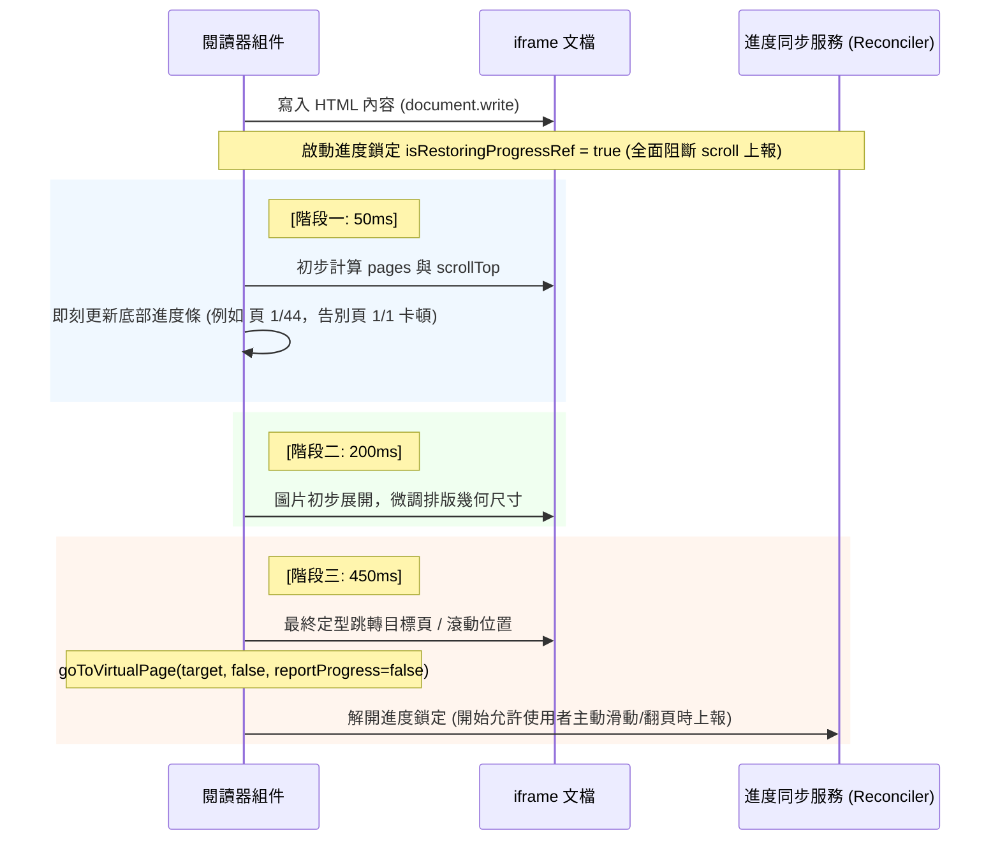

# Kavita Android 客戶端：EPUB 雙軌閱讀架構與實作規範 (Dual-Track Reader Engine)

## 概述 (Overview)
為了解決傳統行動客戶端在線上開啟 EPUB 時「被迫下載整本數十 MB 檔案消耗龐大行動流量」與「本地儲存空間不可控」的瓶頸，本專案實作了完整的**雙軌驅動閱讀引擎（Dual-Track Reader Engine）**。

系統在進入閱讀器時會自動判斷當前章節的儲存狀態，動態切換為「線上串流按需加載」或「離線本地沙盒解析」，兩者無縫對接統一的自訂排版引擎。

---

## 一、 雙軌架構對比 (Dual-Track Architecture)

| 維度 | 軌道 A：離線沙盒模式 (Offline Sandbox) | 軌道 B：線上串流模式 (Online Stream) |
| :--- | :--- | :--- |
| **觸發條件** | 使用者明確點擊頂部「下載」按鈕，書籍已存在於 Android 沙盒 | 書籍未下載至沙盒（一般在線瀏覽與閱讀） |
| **網路依賴** | 100% 離線，完全不需連網（支援飛航模式） | 需要網路連線 |
| **初次開啟流量** | 0 KB（直接讀取沙盒檔案） | **僅約 2 KB**（僅取得章節目錄骨架） |
| **閱讀翻頁流量** | 0 KB | **僅 10~50 KB**（按需抓取當前節純文字 HTML） |
| **整書下載行為** | 僅在點擊下載時下載一次 | **絕對禁止下載整本 EPUB** |
| **核心解析引擎** | 客戶端 `JSZip` 本地解壓骨架與圖片 | 伺服器端解壓串流（Kavita 原生 `BookController`） |
| **儲存空間管理** | 受管於 Android 私有目錄（可由使用者明確管理） | **零磁碟佔用**（僅依賴記憶體分頁暫存） |

---

## 二、 線上串流軌道實作細節 (Online Stream Implementation)

### 1. 開書秒開與骨架載入 (`loadAndParseEpub`)
- 呼叫 Kavita 原生端點：`GET /api/book/{chapterId}/chapters`
- 回傳輕量的目錄結構清單（包含章節標題、頁碼索引）。
- 客戶端直接生成章節骨架陣列 `sections`，耗時僅需 20~50ms，開書載入動畫瞬間完成。

### 2. 單章按需抓取與圖片代理 (`renderCurrentSection`)
- 當翻到第 N 節時，若該節尚未被記憶體快取，呼叫：`GET /api/book/{chapterId}/book-page?page={N}`
- 伺服器僅回傳該單一章節的純文字 HTML（體積僅 10~50 KB）。
- **圖片代理機制**：
  HTML 內部的圖片路徑若為相對路徑，由正規表達式自動補齊伺服器基底 URL 與驗證金鑰：
  ```typescript
  const fullUrl = `${baseUrl}${cleanSrc}?apiKey=${apiKey}`;
  ```
  WebView 僅在該圖片滑入畫面可視區域時，才由瀏覽器底層發起串流獲取，達成真正的「按需圖片串流」。

---

## 三、 排版與閱讀進度還原生命週期 (Layout & Progress Restoration)

為了解決動態排版、字型替換與圖片展開造成的尺寸變動，本引擎採用**三階段極速排版測量與進度鎖定**：



### 關鍵防禦機制：
1. **初始化還原絕不回寫**：`goToVirtualPage` 在開書還原定位時傳入 `reportProgress = false`，絕對禁止向伺服器與資料庫回寫覆蓋。
2. **切換章節明確歸零**：點擊上一章或下一章時，將 `pendingScrollTopRef.current` 設為 `0` 或 `9999999`，新章節寫入時立刻重置滾動位置，杜絕停留在上一章 80% 的比例繼承 Bug。
3. **字型設定即時保存現場**：調整字號、字重或佈局時，若未切換章節，自動讀取當前視窗現場的 `scrollY` 與 `virtualPageIndex`，重繪後停在原處，不跳回頁首。

---

## 4. DOM XPath 官方標準段落路徑同步架構

為與 Kavita 官方 Web 閱讀器及 KOReader 外掛達到 100% 格式互通，客戶端全面改採 **DOM XPath 段落路徑** 替代傳統的設備虛擬分頁碼（`vpage`）：

### 4.1 進度上報（當前可視頁面 ➔ XPath）
- **分頁模式 (Paged)**：翻頁時，自當前視口左上角（直排為右上角）提取首個實質文字節點（`<p>`、`<h1>`~`<h6>` 等），計算其 DOM 結構路徑生成標準 XPath（如 `/body/p[14]`），放入 `bookScrollId` 上報。
- **滾動模式 (Scroll)**：滾動停頓時，依據 `offsetTop` 尋找當前可見頂部的首個段落，生成 XPath 上報。

### 4.2 進度還原（XPath ➔ 畫面精確定位）
- 開書取得 `bookScrollId`（如 `/body/p[14]`）時，利用 iframe 原生 `document.evaluate` 尋獲目標元素：
  - **分頁模式**：計算該段落相對於容器的 `offsetLeft`，換算為目標頁碼 $\text{targetPage} = \lfloor \text{offsetLeft} / \text{pageWidth} \rfloor$，精準翻頁；
  - **滾動模式**：直接調用 `targetEl.scrollIntoView({ behavior: 'auto', block: 'start' })`。
- **排版展開防禦**：待定位的 XPath 目標鎖定至 450ms 最終穩態後才釋放，徹底解決 50ms 頁數未展開導致的頁碼削短 Bug。
- **向下相容**：平滑相容舊版 `vpage:X` 與 `scroll:Y` 格式。
